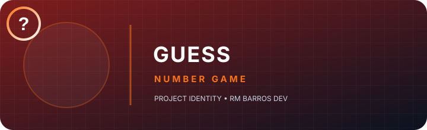

<div align="center">

<p align="center">
  
</p>


# Jogo da Adivinhação

**Um jogo de terminal para praticar lógica e orientação a objetos em C#**

[](https://dotnet.microsoft.com/)
[](https://github.com/RMBarros-Dev/Jogo-da-Adivinha-o)

</div>

## Como funciona

A aplicação escolhe um número de 1 a 100. O jogador tenta descobri-lo dentro do limite de tentativas, recebendo uma dica para cada palpite. Ao terminar, é possível iniciar outra partida.

## Funcionalidades

- Sorteio de um novo número a cada partida
- Dicas para indicar se o palpite está acima ou abaixo do número sorteado
- Validação da entrada
- Opção de jogar novamente

## Tecnologias e conceitos

- C# e .NET 10
- Separação da lógica da partida e do ponto de entrada
- Condicionais, repetição, classes e encapsulamento

## Executar

Requer o .NET 10 SDK. Clone o projeto e execute a aplicação a partir da pasta do repositório:

```bash
git clone https://github.com/RMBarros-Dev/Jogo-da-Adivinha-o.git
cd Jogo-da-Adivinha-o
dotnet run --project "Jogo da Adivinhação/Jogo da Adivinhação.csproj"
```

Também é possível abrir `Jogo da Adivinhação.slnx` no Visual Studio e iniciar o projeto.

## Estrutura

```text
Jogo-da-Adivinha-o/
├── Jogo da Adivinhação/
│   └── Jogo da Adivinhação.csproj
├── partida.cs
└── Jogo da Adivinhação.slnx
```

## Licença

Consulte [LICENSE.txt](LICENSE.txt).
