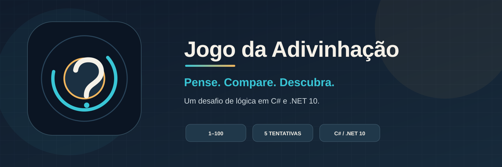
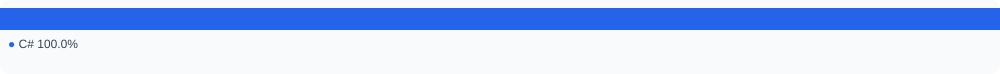

<p align="right"><strong>Idioma:</strong> <a href="README.pt-BR.md">Português (Brasil)</a> · <a href="README.md">English</a></p>

<p align="center"></p>
<p align="center"></p>
<h1 align="center">Jogo da Adivinhação</h1>
<p align="center"><strong>Pense. Compare. Descubra.</strong><br/>Jogo de terminal para praticar lógica, validação de entradas e orientação a objetos em C#.</p>
<p align="center">
  
  
  <a href="https://github.com/RMBarros-Dev/Jogo-da-Adivinha-o/actions/workflows/ci.yml"></a>
  <a href="https://github.com/RMBarros-Dev/Jogo-da-Adivinha-o/actions/workflows/codeql.yml"></a>
</p>

## Índice

- [01 · Visão geral](#01--visão-geral)
- [02 · Objetivo e contexto](#02--objetivo-e-contexto)
- [03 · Como funciona](#03--como-funciona)
- [04 · Regras da partida](#04--regras-da-partida)
- [05 · Validação de entradas](#05--validação-de-entradas)
- [06 · Arquitetura da lógica](#06--arquitetura-da-lógica)
- [07 · Conceitos praticados](#07--conceitos-praticados)
- [08 · Tecnologias](#08--tecnologias)
- [09 · Requisitos](#09--requisitos)
- [10 · Instalação](#10--instalação)
- [11 · Execução](#11--execução)
- [12 · Testes automatizados](#12--testes-automatizados)
- [13 · Aleatoriedade determinística](#13--aleatoriedade-determinística)
- [14 · Estrutura do repositório](#14--estrutura-do-repositório)
- [15 · Qualidade e manutenção](#15--qualidade-e-manutenção)
- [16 · Metodologia de desenvolvimento](#16--metodologia-de-desenvolvimento)
- [17 · Limitações e evolução](#17--limitações-e-evolução)
- [18 · Documentação e licença](#18--documentação-e-licença)

## 01 · Visão geral

Aplicação de console em .NET na qual a pessoa jogadora tenta descobrir um número inteiro sorteado. O projeto é um exercício educacional voltado à lógica, ao tratamento de entradas e à organização de classes.

## 02 · Objetivo e contexto

O objetivo é praticar fundamentos de programação e orientação a objetos em C#, mantendo o escopo deliberadamente pequeno. O repositório não representa um produto de entretenimento com infraestrutura ou serviços online.

## 03 · Como funciona

A aplicação sorteia um número inteiro entre 1 e 100. A pessoa jogadora tem até cinco tentativas válidas e recebe dicas que indicam se o palpite está acima ou abaixo do número secreto. Ao terminar, pode iniciar uma nova partida. A confirmação para jogar novamente aceita apenas `S` ou `N`, sem diferenciar maiúsculas de minúsculas; entradas inválidas solicitam uma nova resposta.

## 04 · Regras da partida

- O número secreto está no intervalo inclusivo de 1 a 100.
- A partida permite cinco tentativas válidas.
- Um palpite correto encerra a partida com vitória.
- As dicas orientam os palpites seguintes.
- É possível iniciar uma nova partida ao final.

## 05 · Validação de entradas

Valores que não podem ser interpretados como inteiros ou que estejam fora do intervalo de 1 a 100 são rejeitados sem consumir uma tentativa. Entradas inválidas não devem alterar o estado da partida.

## 06 · Arquitetura da lógica

A lógica de uma partida é organizada na classe `Partida`, enquanto o ponto de entrada permanece separado. Essa divisão mantém as regras do jogo independentes da interação com o terminal e facilita os testes.

## 07 · Conceitos praticados

- C# e .NET 10.
- Classes e encapsulamento.
- Métodos e separação da lógica de jogo.
- Condicionais e estruturas de repetição.
- Leitura e validação de entradas no terminal.
- Injeção de uma instância de `Random` para permitir testes determinísticos.

## 08 · Tecnologias

| Camada | Tecnologia |
|---|---|
| Linguagem | C# |
| Runtime | .NET 10 |
| Interface | Console |
| Testes | Projeto de testes .NET separado |
| Testabilidade | Instância de `Random` injetável |

## 09 · Requisitos

- SDK do .NET 10.
- Terminal ou IDE compatível com projetos .NET.
- Git para clonar o repositório.

## 10 · Instalação

Clone o repositório e acesse a pasta:

```bash
git clone https://github.com/RMBarros-Dev/Jogo-da-Adivinha-o.git
cd Jogo-da-Adivinha-o
```

## 11 · Execução

```bash
dotnet run --project "Jogo da Adivinhação/Jogo da Adivinhação.csproj"
```

Também é possível abrir `Jogo da Adivinhação.slnx` em uma IDE compatível com .NET.

## 12 · Testes automatizados

O repositório contém um projeto de testes separado em `Jogo da Adivinhação.Tests/`. Execute os testes a partir da raiz:

```bash
dotnet test
```

## 13 · Aleatoriedade determinística

A lógica do jogo pode receber uma instância de `Random`. Nos testes, é possível fornecer um gerador previsível para verificar cenários de vitória, derrota e dicas sem depender de valores aleatórios imprevisíveis.

## 14 · Estrutura do repositório

```text
Jogo-da-Adivinha-o/
├── Jogo da Adivinhação/
│   ├── Jogo da Adivinhação.csproj
│   ├── Partida.cs
│   └── Program.cs
├── Jogo da Adivinhação.Tests/
│   ├── Jogo da Adivinhação.Tests.csproj
│   └── RegrasDaPartidaTests.cs
├── assets/brand/
│   ├── banner.svg
│   ├── logo.svg
│   └── project-mark.svg
├── Jogo da Adivinhação.slnx
└── LICENSE.txt
```

## 15 · Qualidade e manutenção

Mantenha as regras testáveis e a interação com o terminal separada do estado da partida. Ao alterar a implementação, valide os limites do intervalo, entradas inválidas e o comportamento de reiniciar o jogo.

## 16 · Metodologia de desenvolvimento

O exercício favorece mudanças pequenas e incrementais: preservar o comportamento esperado, rejeitar entradas inválidas, isolar as regras da partida e acrescentar testes conforme a lógica evolui.

## 17 · Limitações e evolução

Este é um exercício de aprendizagem. Não inclui contas, rede, persistência, multiplayer ou infraestrutura online. Melhorias futuras devem permanecer proporcionais ao objetivo didático do projeto.

## 18 · Documentação e licença

- [Organização de arquivos](docs/project-structure.md).
- [Identidade visual](docs/brand/README.md).
- [Banner SVG](assets/brand/banner.svg) e [logotipo SVG](assets/brand/logo.svg).
- [Projeto .NET](Jogo%20da%20Adivinha%C3%A7%C3%A3o/Jogo%20da%20Adivinha%C3%A7%C3%A3o.csproj).

Consulte [LICENSE.txt](LICENSE.txt) para os termos da licença.


## Métricas de Engenharia

<div align="center">
  
  
  
  
</div>

<!-- REPOSITORY_METRICS_START -->
### Distribuição de linguagens (GitHub Linguist)



| Linguagem | Bytes de código | Participação |
|---|---:|---:|
| C# | 7,445 | 100.00% |

_Total de bytes de código contabilizados: 7,445. Atualizado em: 2026-11-19 13:04 UTC._

<!-- REPOSITORY_METRICS_END -->

### Verificação técnica

| Dimensão | Evidência implementada | Limite da medição |
|---|---|---|
| Runtime / linguagem | C# com .NET 10 | Confirmado pela documentação e referência ao projeto. |
| Arquitetura | Ponto de entrada do console separado das regras da classe Partida | Aplicação educacional pequena; não se declara camada de serviços ou persistência. |
| Testes automatizados | Projeto .NET de testes separado; injeção determinística de Random | Executar com dotnet test; percentual de cobertura não publicado. |
| CI | [Workflow de CI](.github/workflows/ci.yml) | Resultado atual indicado pelo badge acima. |
| Análise estática de segurança | [Workflow CodeQL](.github/workflows/codeql.yml) | Execução do workflow não equivale a certificação de segurança. |
| Persistência / implantação | Sem armazenamento persistente ou implantação de produção | Não aplicável a este exercício de console. |
