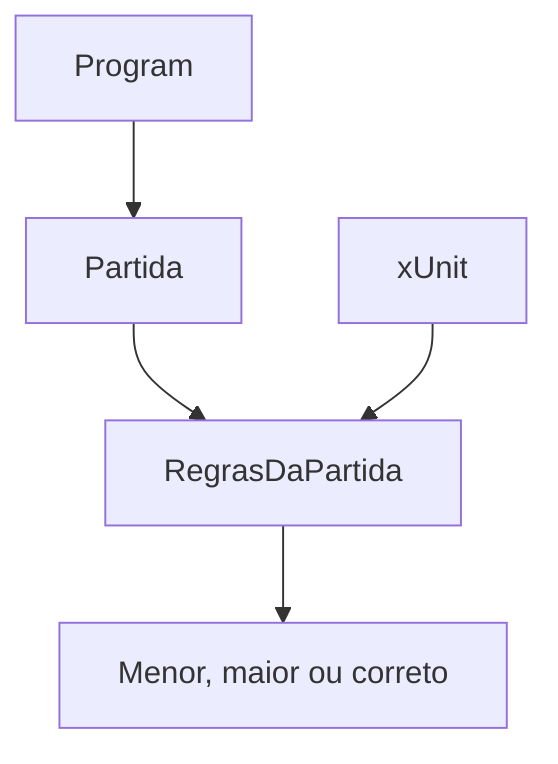

# Arquitetura do Jogo da Adivinhação

## Visão geral

Mantenho o Jogo da Adivinhação como uma aplicação de console em C#. Separei as regras de comparação de palpites da interação com o terminal para permitir testes determinísticos.

## Componentes observados

| Componente | Responsabilidade |
|---|---|
| `Program.cs` | Controla a repetição de partidas |
| `Partida.cs` | Gera o número secreto e conduz as tentativas no console |
| `RegrasDaPartida.cs` | Avalia o palpite sem depender de entrada/saída do console |
| `Jogo da Adivinhação.Tests/` | Testa as regras com xUnit |

## Fluxo

## Regras atuais

- Gero um número secreto entre 1 e 100.
- Limito a partida a cinco tentativas válidas.
- Uma entrada que não pode ser convertida em inteiro não consome uma tentativa.
- Utilizo a classe `RegrasDaPartida` para avaliar o palpite sem acessar o console.

## Qualidade

O workflow restaura e compila a solução .NET e executa a suíte xUnit para as regras de comparação e os limites do número secreto.

## Referências

- [README](../../README.md)
- [Contribuição](../../CONTRIBUTING.md)
- [Política de segurança](../../SECURITY.md)
- [Decisão arquitetural atual](../decisions/0001-current-architecture.md)
